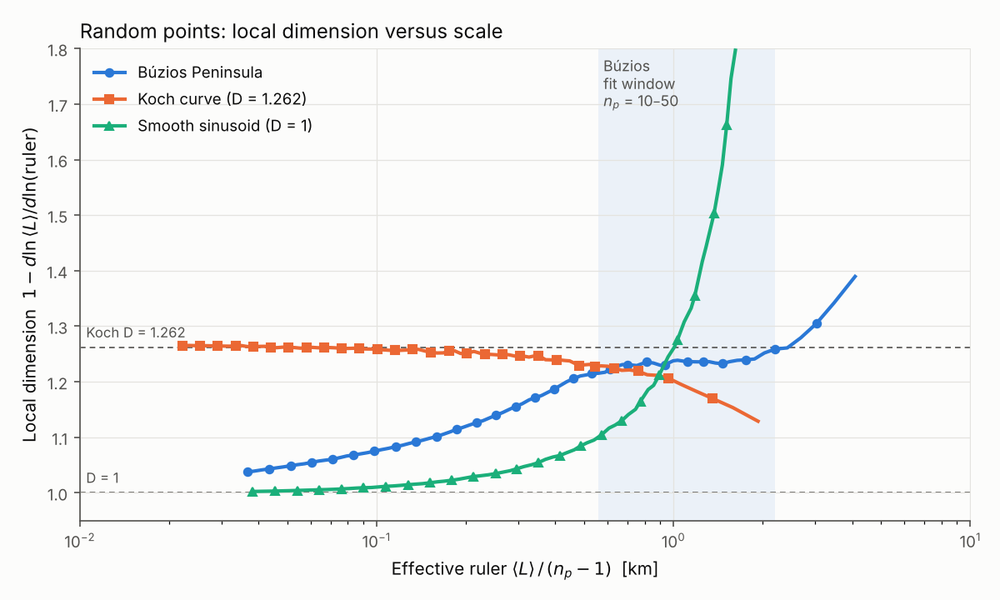
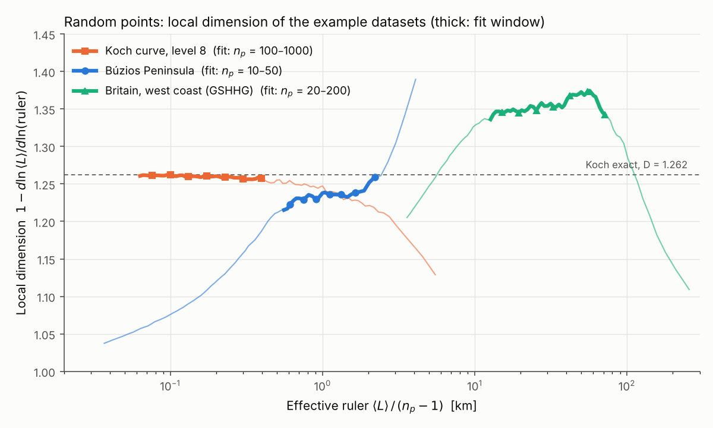

# Coastline length sampling: random-points and yardstick estimators

Monte-Carlo sampling distributions of the *measured* length of a coastline, for two
estimators (random points and yardstick), followed by a Monte-Carlo fit of a power
law to length versus resolution.

| Stage | Script | Input | Output |
|---|---|---|---|
| 1. Sampling | `coastline_run.py` | digitised coastline (lat, lon) | `P(L \| resolution)` for every resolution of a sweep |
| 2. Fit | `coastline_mc_fit.py` | stage-1 archive | distribution of the fitted power-law parameters |

Stage 1 measures the same curve many times with a randomised estimator and stores the
distribution of the lengths obtained at each resolution. Stage 2 builds
length-versus-resolution curves from those distributions, fits
`L(n_p) = L0 * (n_p - 1)**beta` to each curve, and reports the distribution of `beta`,
`D = 1 / (1 - beta)`, `L0` and `A`.

The spread of `P(L | resolution)` is the variability of the measuring method itself,
not a measurement-error model. Before interpreting a fitted `D`, read
[Interpreting the fitted dimension](#interpreting-the-fitted-dimension).

## Highlights

- Exact great-circle geometry on the sphere; open coastlines and closed rings
  (islands), with antimeridian crossing handled.
- Stations drawn uniformly in true arc length, through an adaptively refined
  arc-length map with a measured distortion below `--map-tol`.
- Yardstick on the input polyline with an exact segment-by-segment walker, which
  cannot miss a crossing.
- Nested random-points sweep: every `n_p` from one draw per realisation, at the cost
  of the largest `n_p` only.
- Results independent of `--n-jobs` and chunk sizes; NumPy and Numba engines agree to
  round-off.
- Every archive records its full configuration, map diagnostics and software
  versions.
- Three example datasets with ready-to-run scripts: a Koch curve of known dimension,
  the Búzios peninsula (Brazil) and the west coast of Britain (GSHHG).

## Contents

- [Repository layout](#repository-layout)
- [Installation](#installation)
- [Example datasets](#example-datasets)
- [Quick start](#quick-start)
- [Input data](#input-data)
- [Curve model](#curve-model)
- [Estimators](#estimators)
- [Interpreting the fitted dimension](#interpreting-the-fitted-dimension)
- [Stage 1 reference: `coastline_run.py`](#stage-1-reference-coastline_runpy)
- [Restrictions and constraints](#restrictions-and-constraints)
- [Stage 1 outputs](#stage-1-outputs)
- [Stage 2 reference: `coastline_mc_fit.py`](#stage-2-reference-coastline_mc_fitpy)
- [Reproducibility and verification](#reproducibility-and-verification)
- [Performance and memory](#performance-and-memory)
- [Known limitations](#known-limitations)
- [Modules](#modules)

## Repository layout

```
coastline_config.py          RunConfig: validated configuration, CLI parser, JSON
coastline_geometry.py        input readers, CoastlineModel (curve, arc-length map)
coastline_estimators.py      random-points and yardstick estimators, ruler limits
coastline_kernels.py         compiled (Numba) kernels of the estimators
coastline_run.py             stage 1: sweep driver, statistics, archive
coastline_mc_fit.py          stage 2: Monte-Carlo power-law fit

Buzios_Peninsula.kml                   example: Búzios peninsula, Brazil (KML)
koch_8_theta60.txt                     example: Koch curve, level 8 (synthetic, D known)
britain_west_gshhg.txt                 example: west coast of Britain (GSHHG 2.3.7)
run_Buzios_Peninsula_RP_kml.sh         random points + fit, Búzios
run_Buzios_Peninsula_YS_kml_fit.sh     yardstick + fit, Búzios
run_koch_8_RP.sh                       random points + fit, Koch
run_koch_8_YS_fit.sh                   yardstick + fit, Koch
run_Britain_West_RP.sh                 random points + fit, Britain
run_Britain_West_YS_fit.sh             yardstick + fit, Britain

calibration/make_test_curves.py        Koch curve (D = 1.262) and smooth sinusoid (D = 1)
calibration/run_calibration.sh         runs the Búzios settings on all three curves
calibration/plot_local_dimension.py    draws docs/local_dimension.png
docs/plot_datasets.py                  draws docs/local_dimension_datasets.png
docs/*.png                             figures used in this README
```

## Installation

| Package | Needed for |
|---|---|
| Python 3 | everything (tested with 3.12 and 3.13) |
| NumPy, SciPy | everything |
| Numba | `--engine numba` only |
| joblib | `--n-jobs` other than 1 only |
| Matplotlib | the calibration figure only |

```bash
pip install -r requirements.txt     # or just: pip install numpy scipy
```

There is nothing to build. Run the scripts from the repository root (all six modules
must be in the same directory or on `PYTHONPATH`). The Numba kernels are compiled on
first use and cached.

## Example datasets

| Dataset | File | Vertices | Length | Spacing | Fit windows |
|---|---|---|---|---|---|
| Koch curve, level 8 | `koch_8_theta60.txt` | 65 537 | 199.77 km | 3.05 m (uniform) | RP `n_p` 100–1000; YS 0.063–0.439 km |
| Búzios peninsula, Brazil | `Buzios_Peninsula.kml` | 489 | 38.2 km | 61 m (median) | RP `n_p` 10–50; YS 0.585–2.34 km |
| Britain, west coast | `britain_west_gshhg.txt` | 26 706 | 5470 km | 142 m (median) | RP `n_p` 20–200; YS 13.7–74.8 km |

- **Koch curve** (synthetic validation): eight generations of the 60° Koch
  construction on a 20 km base at the equator, so `L = 20 (4/3)^8` km and
  `D = log 4 / log 3 = 1.2619` exactly.
- **Búzios peninsula**: a stretch of the Búzios peninsula (Rio de Janeiro, Brazil),
  digitised as a single KML line.
- **West coast of Britain**: Land's End to Cape Wrath, an approximate extract of the
  full-resolution (level 1) shoreline of GSHHG version 2.3.7. GSHHG is distributed
  under the GNU Lesser General Public License, version 3 or later. Cite it as:
  Wessel, P., and W. H. F. Smith (1996), A global, self-consistent, hierarchical,
  high-resolution shoreline database, *J. Geophys. Res.*, 101(B4), 8741–8743,
  [doi:10.1029/96JB00104](https://doi.org/10.1029/96JB00104).

Each dataset has two scripts, one per estimator; each runs stage 1 and then stage 2.
The fit windows were chosen on the plateau of the local dimension of each curve (see
[Results on the example datasets](#results-on-the-example-datasets)).

## Quick start

```bash
bash run_koch_8_RP.sh                     # Koch: random points + fit
bash run_koch_8_YS_fit.sh                 # Koch: yardstick + fit
bash run_Buzios_Peninsula_RP_kml.sh       # Búzios
bash run_Buzios_Peninsula_YS_kml_fit.sh
bash run_Britain_West_RP.sh               # Britain
bash run_Britain_West_YS_fit.sh
python docs/plot_datasets.py              # plateau figure of the three RP runs
```

Results are written to `koch_8_results/`, `Buzios_Peninsula_kml_results/` and
`Britain_West_results/`. Each RP script stores 996 resolutions × 100 000 realisations
and needs about 4–5 GB of RAM; see [Performance and memory](#performance-and-memory)
for a lighter variant. Each YS script runs 10⁶ surveys per ruler; on the Koch curve
(about 1000 stations per survey at the smallest ruler) this takes of the order of 10
minutes on 12 threads.

Smaller runs, one stage at a time:

```bash
# Random points, nested sweep, logarithmic spacing
python coastline_run.py --input-file Buzios_Peninsula.kml --input-format kml \
    --method rp --rp-start 5 --rp-stop 1000 --rp-spacing log --rp-per-decade 40 \
    --save-samples --engine numba --prefix buzios_rp

# Yardstick on the input polyline (the default walker for linear interpolation)
python coastline_run.py --input-file Buzios_Peninsula.kml --input-format kml \
    --method ys --ys-start 0.585 --ys-stop 2.34 --ys-num 20 --engine numba \
    --prefix buzios_ys

# Fit, keeping the correlation between the resolutions of each realisation
python coastline_mc_fit.py --input results/buzios_rp/buzios_rp_pdfs.npz \
    --curves realisation --np-min 10 --np-max 50 --fit loglog nonlinear
python coastline_mc_fit.py --input results/buzios_ys/buzios_ys_pdfs.npz \
    --curves realisation
```

An island (closed ring):

```bash
python coastline_run.py --input-file island.txt --input-format latlon \
    --topology closed --method rp --rp-start 10 --rp-stop 100 --prefix island_rp

python coastline_run.py --input-file island.txt --input-format latlon \
    --topology closed --method ys --end-policy keep --ys-stop 5 --engine numba \
    --prefix island_ys
```

The same run from a JSON file (keys are the flag names with underscores; flags given
on the command line override the file):

```json
{
  "input_file": "Buzios_Peninsula.kml",
  "input_format": "kml",
  "method": "ys",
  "ys_start": 0.585,
  "ys_stop": 2.34,
  "ys_num": 20,
  "engine": "numba",
  "prefix": "buzios_ys"
}
```

```bash
python coastline_run.py --config run.json --n-realisations 2000
```

From Python:

```python
from coastline_config import RunConfig
from coastline_run import run_campaign
from coastline_mc_fit import run_mc

cfg = RunConfig(input_file="Buzios_Peninsula.kml", input_format="kml",
                method="rp", rp_start=5, rp_stop=1000, rp_spacing="log",
                save_samples=True, prefix="buzios_rp")
archive = run_campaign(cfg)                       # also writes the files
fit = run_mc("results/buzios_rp/buzios_rp_pdfs.npz", curves="realisation",
             np_min=10, np_max=50)
```

## Input data

A single line of (latitude, longitude) points in decimal degrees, in order along the
coast. The format is always given explicitly with `--input-format`; the file
extension is not used.

| `--input-format` | Content |
|---|---|
| `latlon` | text, two numeric columns: latitude, longitude |
| `lonlat` | text, two numeric columns: longitude, latitude |
| `kml` | KML or KMZ containing exactly one `LineString` / `LinearRing` |

Rules enforced when the file is read and the model is built:

- Text files: columns separated by spaces, tabs or commas; `.` as decimal mark;
  lines starting with `#` are comments. `;` separators and decimal commas are not
  supported.
- KML: tuples are `lon,lat[,alt]`; altitude is ignored, `Point` placemarks are
  ignored. A file with no line geometry, or with more than one, is rejected. A KMZ
  must contain exactly one `.kml` entry. A line drawn in Google My Maps or Google
  Earth and exported as KML/KMZ works as is.
- All values finite, `|lat| <= 90`, `|lon| <= 180`.
- At least 4 points for an open curve, at least 3 for a closed one.
- No two consecutive points may coincide (deduplicate the input first).
- Swapped columns cannot always be detected (when both columns are within ±90 the
  file is valid either way). The run prints the latitude and longitude ranges it
  read: check them.

Longitudes are unwrapped internally, so a line may cross the antimeridian.

## Curve model

Distances are great-circle distances on a sphere of radius 6371 km. All lengths are
in km.

The coastline is a continuous curve through the input points: `lat` and `lon` are
interpolated as functions of the chordal parameter `t` (cumulative great-circle
distance along the input polyline).

| `--interpolation` | Curve |
|---|---|
| `linear` (default) | the input polyline; segments are straight in (lat, lon) |
| `akima` | Akima interpolant |
| `cubic` | cubic spline (not-a-knot) |

A second layer maps true arc length `s` to `t`, so that stations can be drawn
uniformly *along the curve*. The map is refined adaptively until its density
distortion `|q - 1|` is below `--map-tol`. The reference length of the curve
(`reference_length_km`) is the arc length of the interpolant; `polyline_length_km`
is the length of the input polyline. They coincide for `linear`.

### Topology

| `--topology` | Meaning |
|---|---|
| `open` (default) | a line with two end points |
| `closed` | a ring (island, lake). The first point is appended as closing vertex when the file does not already end on it |

For a closed ring, a last point closer than 1e-9 km to the first is treated as the
closing vertex; otherwise a closing segment is added, and a warning is issued when
that segment is more than 10 times the median input segment (the data probably do
not cover a whole ring). The archive records `closure_added` and `closure_gap_km`.

## Estimators

In both estimators `n_p` counts measuring stations and `n_p - 1` is the number of
measured chords, for open and closed curves alike.

### Random points (`--method rp`)

`n_p` stations are drawn uniformly along the curve and joined in order by
great-circle chords; the length is the sum of the chords. One sweep value is one
`n_p`.

| Topology | Stations | Chords |
|---|---|---|
| open | the two end points (fixed) + `n_p - 2` random stations | `n_p - 1` |
| closed | `n_p - 1` random stations joined cyclically; the repeated start is counted as station `n_p` | `n_p - 1` |

`--rp-sweep` selects how the sweep is drawn:

- `nested` (default): one set of stations per realisation serves every `n_p` (the
  configuration with `n` points uses the first draws only; points are removed one at
  a time, each removal costing one new chord). Each `P(L | n_p)` is exactly the same
  distribution as with `independent`, but values at different `n_p` of one
  realisation are dependent. Cost grows with the largest `n_p` only.
- `independent`: every `n_p` uses its own random stations. Realisations are
  independent across `n_p`. Cost grows with the sum of all `n_p`.

### Yardstick (`--method ys`)

A ruler of fixed length `d` (km) is stepped along the curve: each new station is the
*first* point whose great-circle distance from the current station equals `d`. One
sweep value is one ruler.

**Open curve.** The walk starts at a seed station drawn uniformly in arc length and
proceeds in both directions. `--end-policy` decides what happens to the two end
fragments (from the last station on each side to the end of the curve):

| `--end-policy` | Length | `n_p` |
|---|---|---|
| `merge` (default) | a fragment shorter than `d / 2` is merged into the last chord of that side (that station is removed and one chord runs from the previous station to the end); otherwise it is kept | `steps + 3`, minus 1 per merged side |
| `keep` | both fragments are added as they are | `steps + 3` |
| `drop` | both fragments are discarded | `steps + 1` |

A zero-length fragment (a station exactly on an end point) is not counted as an extra
station.

**Closed ring.** One full lap from a seed station drawn uniformly in arc length, in
a random orientation (each with probability 1/2), plus one closing chord from the
last station back to the seed. `n_p = steps + 2` (the repeated start is counted), or
`steps + 1` when the last step lands exactly on the seed.

`--ys-walker` selects how each station is found:

- `auto` (default): `polyline` for `--interpolation linear`, `march` otherwise. The
  resolved walker is what the archive and the saved configuration record.
- `polyline`: for `--interpolation linear` only. The divider circle is convex and the
  segments are straight, so a segment with both ends inside the circle lies inside
  it, and the first crossing lies on the segment ending at the first vertex outside
  the circle. Only vertices are tested (those nearer along the path than the current
  shortfall are skipped) and no crossing can be missed. Subject to the ruler limits
  listed under [Data-dependent limits](#data-dependent-limits).
- `march`: works on any interpolant. Because a chord grows by at most
  `arc_lipschitz * ds` when its far end moves by `ds`, the search advances in steps
  that cannot overshoot a crossing, never smaller than `1e-3 * d`, and then refines
  the crossing with a bracketing root finder (Illinois) to `|chord - d| <= 1e-8 * d`.
  An excursion of the chord above `d` narrower than `1e-3 * d` can be stepped over
  (see [Known limitations](#known-limitations)).

In both walkers the interior length is the sum of the chords actually obtained, not
`steps * d`, so it does not depend on the root tolerance.

`--ys-seeds` selects the seed stations: `common` (default) reuses the same seeds
(and, on a closed ring, the same orientations) for every ruler, so that one
realisation is a whole survey across rulers; `independent` draws new seeds for every
ruler. Each `P(L | d)` is the same either way.

## Interpreting the fitted dimension

A power law fitted over a finite window of resolutions returns a number whether or
not the curve is self-similar in that window. Two checks are therefore part of any
analysis: **calibration** on curves of known dimension, and a **plateau test** of
the local dimension across scales.

### Calibration

`calibration/run_calibration.sh` builds two test curves matched to the Búzios example
in size (about 7 km between the end points and 38–39 km along the curve, at the same
latitude, sampled every ~10 m) and runs them through both stages with the Búzios
settings: random points over `n_p = 10..50`, yardstick over rulers 0.585–2.34 km.

Median `D` and 16–84 % range of the fits to individual realisations (10 000 RP and
20 000 YS realisations):

| Curve | True `D` | Random points, `n_p` 10–50 | Yardstick, 0.585–2.34 km |
|---|---|---|---|
| Koch curve | 1.262 | 1.232 [1.186, 1.288] | 1.253 [1.214, 1.286] |
| Smooth sinusoid | 1.000 | 1.468 [1.281, 1.744] | 1.254 [1.183, 1.291] |
| Búzios Peninsula | – | 1.230 [1.173, 1.302] | 1.229 [1.209, 1.250] |

On the Koch curve both estimators come close to the true value (random points is
biased low by about 0.03). On a *smooth* curve whose wiggles are about the size of
the fit window, both return `D > 1`, and the yardstick result cannot be told apart
from the Koch curve's. A fitted `D > 1` in one window is therefore not, by itself,
evidence of fractal structure.

### Plateau test

The stage-1 archive stores the local dimension at every resolution
(`richardson_dimension` against `effective_ruler_km`). A self-similar curve keeps it
constant over a range of scales; a smooth curve tends to 1 below its feature size.



The Koch curve stays within 0.03 of 1.26 from 0.02 to 0.7 km; the sinusoid falls to 1 below about
0.3 km. Búzios has a short plateau at about 1.22–1.26 over 0.6–2.2 km, which is the
fit window, and falls towards 1 at smaller scales. That fall is forced by the data:
below a few hundred metres the measurement sees the straight segments of a polyline
with 61 m median spacing. The fitted value is best reported as an effective exponent
over the scales of the window (here 0.6 decades), together with the plateau plot;
only finer digitisation can extend the range.

The random-points local dimension is smooth enough to read directly. The yardstick
one, from 20 rulers, oscillates and is better judged from the fit.

### Results on the example datasets

Settings of the six example scripts, with fewer realisations (10 000 RP with
logarithmic spacing, 20 000 YS); median `D` and 16–84 % range of the fits to
individual realisations (`--curves realisation`, `--fit nonlinear`):

| Dataset | Random points | Yardstick |
|---|---|---|
| Koch curve, level 8 (exact 1.2619) | 1.2600 [1.2484, 1.2720] | 1.2630 [1.2613, 1.2646] |
| Búzios peninsula | 1.230 [1.173, 1.302] | 1.229 [1.209, 1.250] |
| Britain, west coast | 1.353 [1.296, 1.420] | 1.332 [1.320, 1.345] |



- **Koch curve.** Both estimators recover the exact dimension to within 0.002. The
  random-points local dimension is flat (1.260–1.261) across the fit window. The
  yardstick on an exactly self-similar curve is a staircase: the station count stays
  at 1024, 512, 256, … over ranges of rulers, so its fitted `D` depends on where the
  window falls within the factor-3 cycle. Windows of the same width shifted by a
  quarter, a half and three quarters of a cycle gave 1.259–1.269, and a window of
  ratio 9 gave 1.284. The yardstick validation is therefore good to about ±0.01–0.02;
  natural coastlines are not exactly self-similar and do not show this staircase.
- **Búzios.** A short plateau (0.6–2.2 km, about 0.6 decades), bounded below by the
  digitisation; see [Plateau test](#plateau-test).
- **West coast of Britain.** The random-points local dimension has a plateau at
  1.34–1.37 between about 14 and 66 km and falls on both sides (1.21 at 3.6 km, 1.23
  at 130 km); the fit window, 12.6–71.6 km in effective ruler, lies on it. The two
  estimators differ by 0.02, which is best reported as a systematic uncertainty of
  the method. The classical value for this coast, D ≈ 1.25 (Mandelbrot 1967, *Science*
  156, 636–638, from Richardson's data), was obtained from other maps and over another
  range of scales.

The values in these tables come from shortened runs; the full example scripts use
10⁵ (RP) and 10⁶ (YS) realisations.

## Stage 1 reference: `coastline_run.py`

```
python coastline_run.py --input-file FILE --input-format {kml,latlon,lonlat} [options]
python coastline_run.py --config FILE.json [options]
```

`--input-file` and `--input-format` are required, on the command line or in the
JSON file. Every other option has a default. `python coastline_run.py --help` lists
them with their defaults.

### General

| Flag | Values | Default | Meaning |
|---|---|---|---|
| `--config` | path | – | JSON file with option values; command-line flags override it |
| `--input-file` | path | required | coastline file |
| `--input-format` | `kml`, `latlon`, `lonlat` | required | see [Input data](#input-data) |
| `--method` | `rp`, `ys` | `rp` | estimator |
| `--topology` | `open`, `closed` | `open` | line with end points, or ring |

### Random-points sweep (`--method rp`)

| Flag | Values | Default | Meaning |
|---|---|---|---|
| `--rp-start` | integer ≥ 3 | 5 | first `n_p` |
| `--rp-stop` | integer | 1000 | last `n_p`, inclusive (never exceeded) |
| `--rp-spacing` | `linear`, `log` | `linear` | spacing of the `n_p` values |
| `--rp-step` | integer ≥ 1 | 1 | increment, with `--rp-spacing linear` |
| `--rp-per-decade` | integer ≥ 1 | 20 | intervals per decade, with `--rp-spacing log` (values are rounded to integers and duplicates removed) |

### Yardstick sweep (`--method ys`)

Rulers are spaced geometrically between the two ends.

| Flag | Values | Default | Meaning |
|---|---|---|---|
| `--ys-start` | km, > 0 | 0.05 | smallest ruler |
| `--ys-stop` | km, > `--ys-start` | 10.0 | largest ruler |
| `--ys-num` | integer ≥ 2 | 10 | number of rulers |

### Monte Carlo

| Flag | Values | Default | Meaning |
|---|---|---|---|
| `--n-realisations` | integer ≥ 2 | 10000 | realisations per resolution |
| `--n-bins` | integer ≥ 10 | 50 | bins of the stored histogram of `L` at each resolution |
| `--seed` | integer | 20250101 | master seed |

### Curve model

| Flag | Values | Default | Meaning |
|---|---|---|---|
| `--interpolation` | `linear`, `akima`, `cubic` | `linear` | curve through the input points |
| `--quad-order` | integer ≥ 2 | 10 | Gauss–Legendre nodes per quadrature panel of the arc length |
| `--subdivisions` | integer ≥ 1 | 16 | initial cells of the `s`↔`t` map per input segment (refined adaptively; 1 is enough for `linear`) |
| `--map-tol` | > 0 | 1e-6 | largest density distortion `\|q - 1\|` accepted for the `s`↔`t` map |
| `--map-max-nodes` | integer ≥ 10 | 2000000 | cap on the size of the `s`↔`t` map (a warning is issued if it is reached) |

### Method options

| Flag | Values | Default | Used by | Meaning |
|---|---|---|---|---|
| `--rp-sweep` | `nested`, `independent` | `nested` | RP | see [Random points](#random-points---method-rp) |
| `--uniform-in` | `arc`, `chordal` | `arc` | RP | draw stations uniformly in true arc length, or in the chordal parameter `t` |
| `--ys-walker` | `auto`, `polyline`, `march` | `auto` | YS | see [Yardstick](#yardstick---method-ys) |
| `--ys-seeds` | `common`, `independent` | `common` | YS | the same seed stations for every ruler, or new ones |
| `--end-policy` | `merge`, `keep`, `drop` | `merge` | YS | treatment of the end fragments (open); must be `keep` on a closed ring |

### Execution and output

| Flag | Values | Default | Meaning |
|---|---|---|---|
| `--engine` | `numpy`, `numba` | `numpy` | vectorised NumPy, or compiled kernels; same results up to round-off |
| `--n-jobs` | integer ≠ 0 | 1 | worker processes; negative values follow joblib (`-1` = all cores) |
| `--chunk-elements` | integer ≥ 1 | 1048576 | elements per work array (memory knob; results do not depend on it) |
| `--output-dir` | path | `results` | parent directory of the outputs |
| `--prefix` | string | `run` | run name: sub-directory and file prefix |
| `--save-samples` / `--no-save-samples` | switch | off | RP: also store every length sample (YS samples are always stored). Needed by stage 2 with `--curves samples` or `realisation` |

## Restrictions and constraints

### Combinations of options

Checked when the configuration is built, before any data are read. A violation stops
the run with an error message.

| Option | Requires |
|---|---|
| `--topology closed` | `--interpolation linear` |
| `--ys-walker polyline` (with `--method ys`) | `--interpolation linear` |
| `--topology closed` with `--method ys` | `--ys-walker polyline` (or `auto`) **and** `--end-policy keep` |
| `--engine numba` | the `numba` package installed |
| `--rp-spacing linear` | `--rp-step >= 1` and `--rp-stop >= --rp-start` |
| `--rp-spacing log` | `--rp-stop > --rp-start` and `--rp-per-decade >= 1` |
| `--method ys` | `0 < --ys-start < --ys-stop` and `--ys-num >= 2` |

The resulting valid combinations:

| Topology | Method | Interpolation | `--ys-walker` | `--end-policy` |
|---|---|---|---|---|
| open | RP | any | – | – |
| open | YS | `akima`, `cubic` | `march` (`auto`) | any |
| open | YS | `linear` | `polyline` (`auto`) or `march` | any |
| closed | RP | `linear` | – | – |
| closed | YS | `linear` | `polyline` (`auto`) | `keep` |

With the defaults, a closed ring works as is for RP; for YS add `--end-policy keep`.

### Value ranges

| Option | Constraint |
|---|---|
| `--rp-start` | ≥ 3 |
| `--n-realisations` | ≥ 2 |
| `--n-bins` | ≥ 10 |
| `--n-jobs` | ≠ 0 |
| `--map-tol` | > 0 |
| `--quad-order` | ≥ 2 |
| `--subdivisions` | ≥ 1 |
| `--map-max-nodes` | ≥ 10 |
| `--chunk-elements` | ≥ 1 |

The RP sweep options are validated only with `--method rp`, and the YS sweep options
only with `--method ys`.

### Data-dependent limits

These depend on the coastline itself. They are checked after the curve is built and
before the sweep starts, so a run that violates them stops immediately instead of
failing at its last ruler.

| Limit | Applies to | Condition on the largest ruler |
|---|---|---|
| Polyline ruler limit | `--ys-walker polyline` | `ys_stop < R * (pi/2 - max\|lat\|)`, the distance from the curve to the nearest pole |
| Closed ruler limit | `--topology closed` with `--method ys` | `ys_stop <` a certified lower bound on the ruler at which every seed station can still take a step |

*Polyline ruler limit.* A segment that is straight in (lat, lon) is not a geodesic.
The convexity argument of the polyline walker holds while the ruler is shorter than
the distance to the nearest pole: about 7450 km for a coast at 23° latitude, 334 km
at 87°. It is not a practical restriction away from the poles. The value is stored
in the metadata as `polyline_ruler_limit_km`.

*Closed ruler limit.* When the whole ring fits inside the divider circle of a seed
station, a lap from that station has no step. Whether this happens depends on where
the lap starts, so a ruler in that range is refused altogether instead of failing
for some seeds only. The bound is computed from a set of farthest-first witness
vertices and a Lipschitz argument, refined only where the requested ruler is not yet
certified; it never needs all N² vertex distances. It is a sufficient bound, so it
can be smaller than the true threshold: a refusal does not prove that some lap would
fail. It is stored as `closed_ruler_limit_km`.

### Options ignored by the other method

Options that belong to one estimator are accepted but have no effect with the other:

| With `--method rp`, ignored | With `--method ys`, ignored |
|---|---|
| `--ys-start`, `--ys-stop`, `--ys-num`, `--ys-seeds`, `--ys-walker`, `--end-policy` | `--rp-start`, `--rp-stop`, `--rp-step`, `--rp-spacing`, `--rp-per-decade`, `--rp-sweep`, `--uniform-in`, `--save-samples` |

### Other behaviour worth knowing

- A sweep with a single resolution is allowed; its local dimension is `NaN`. The fit
  stage needs at least 3 resolutions.
- Output files of an earlier run with the same `--output-dir` and `--prefix` are
  overwritten without warning.
- Unknown keys in a `--config` file are rejected. The JSON file and the command-line
  flags are merged first and validated together, so the file may be incomplete.

## Stage 1 outputs

Written to `<output-dir>/<prefix>/`:

| File | Content |
|---|---|
| `<prefix>_pdfs.npz` | the archive read by stage 2 (archive version 9) |
| `<prefix>_summary.csv` | one row per resolution: statistics of `L` and of `n_p` |
| `<prefix>_config.json` | the complete configuration of the run; can be passed back with `--config` |

Columns of the CSV: `resolution`, `effective_ruler_km`, `richardson_dimension`,
`mean`, `std`, `median`, `skewness`, `kurtosis`, `minimum`, `p2_5`, `q1`, `q3`,
`p97_5`, `maximum`, `n_points_mean`, `n_points_std`.

Main arrays of the archive (`K` resolutions, `M` realisations):

| Key | Shape | Content |
|---|---|---|
| `resolution`, `resolution_label` | `(K,)`, scalar | sweep values; `n_points` (RP) or `ruler_km` (YS) |
| `mean`, `std`, `median`, `skewness`, `kurtosis`, `minimum`, `p2_5`, `q1`, `q3`, `p97_5`, `maximum` | `(K,)` | statistics of `L` at each resolution |
| `length_hist_counts`, `length_hist_density`, `length_bin_edges` | `(K, n_bins)`, `(K, n_bins)`, `(K, n_bins + 1)` | histogram of `L` at each resolution |
| `hist_is_pointmass`, `hist_pointmass` | `(K,)` | flags a resolution whose lengths are numerically identical, and that value |
| `effective_ruler_km` | `(K,)` | RP: `mean / (n_p - 1)`; YS: the ruler |
| `richardson_dimension` | `(K,)` | local estimate `1 - d ln<L> / d ln(effective ruler)` |
| `n_points_mean`, `n_points_std`, `n_points_min`, `n_points_max` | `(K,)` | statistics of `n_p` |
| `length_samples` | `(K, M)` | every length; YS always, RP with `--save-samples` |
| `n_points_samples`, `n_points_support`, `n_points_pmf`, `n_points_pmf_counts` | YS only | `n_p` of every realisation and its distribution |
| `reference_length_km`, `polyline_length_km` | scalars | length of the interpolated curve and of the input polyline |
| `method`, `topology`, `engine`, `rp_sweep`, `ys_seeds`, `ys_walker`, `archive_version` | scalars | provenance |
| `metadata_json` | string | full configuration, map diagnostics, limits, closure information, software versions, wall time |

## Stage 2 reference: `coastline_mc_fit.py`

```
python coastline_mc_fit.py --input <prefix>_pdfs.npz --curves {histogram,samples,realisation} [options]
```

Model, with `x = n_p - 1` (the number of chords) and `beta = 1 - 1/D`:

```
L(n_p) = L0 * x**beta = A * (x / x_c)**beta
```

`beta` is the fitted exponent; `D = 1 / (1 - beta)` is derived from it (`NaN` when
`beta >= 1`). `L0` is the model value at `n_p = 2`, an extrapolation far outside the
data and therefore strongly correlated with `beta`. `A` is the model value at the
pivot `n_p = x_c + 1`; the pivot changes how the amplitude is reported, never the
fitted curve.

For the yardstick, `n_p` is the station count of each survey, a random integer. A
fit of `ln L` against `ln d` (the classical Richardson plot, `L ∝ d^(1 - D)`) is a
useful cross-check; on the Búzios example the two agree within about 0.007 in `D`.

### Curves

`--curves` is required and decides how a length-versus-resolution curve is built:

| `--curves` | A curve is | Needs from stage 1 |
|---|---|---|
| `histogram` | one independent draw per resolution from the stored histogram | RP archive (not available for YS) |
| `samples` | one independent draw per resolution from the stored samples; for YS an `(n_p, L)` pair | RP: `--save-samples`; YS: nothing extra |
| `realisation` | one stored realisation across all resolutions, each fitted exactly once | RP: `--rp-sweep nested --save-samples`; YS: `--ys-seeds common` |

`histogram` and `samples` give curves whose resolutions are independent;
`realisation` keeps the correlation between the resolutions of one realisation.
Comparing `samples` with `realisation` isolates the effect of that correlation;
comparing `histogram` with `samples` isolates the effect of binning.

### Estimators and weights

- `--fit loglog`: closed-form weighted least squares on `ln L = ln A + beta ln(x / x_c)`.
- `--fit nonlinear`: least squares on `L = A (x / x_c)**beta`, with the amplitude
  profiled out. The default solver runs Newton on the profiled objective from the
  `loglog` estimate and falls back to a grid + bisection on any curve where Newton
  fails or leaves the `--beta-min`/`--beta-max` interval.
- `--weights inverse-variance`: fixed per resolution from the archive; `1 / var(L)`
  for `nonlinear`, `mean**2 / var(L)` for `loglog`. `var(L)` is the spread of the
  method, so these weights favour the resolutions at which it is most reproducible.

With linearly spaced resolutions and unit weights, the upper part of the window
carries most of the weight in log space; logarithmic spacing or `loglog` balances it.

### Flags

| Flag | Values | Default | Meaning |
|---|---|---|---|
| `--input` | path | required | `<prefix>_pdfs.npz` from stage 1 (archive version ≥ 6) |
| `--curves` | `histogram`, `samples`, `realisation` | required | see above |
| `--n-sim` | integer ≥ 2 | 100000 | accepted curves for `histogram` and `samples`; ignored by `realisation` |
| `--seed` | integer | 20260814 | seed for `histogram` and `samples`; ignored by `realisation` |
| `--np-min`, `--np-max` | number | none | range of `n_p` kept in the fit (YS: mean `n_p` of each ruler) |
| `--fit` | one or more of `loglog`, `nonlinear` | `loglog` | least squares on `ln L`, or directly on `L` |
| `--weights` | one or more of `none`, `inverse-variance` | `none` | weights per resolution; applied to every `--fit` |
| `--pivot` | `auto`, `weights`, or a number > 1 | `auto` | `n_p` at which `A` is reported: `auto` makes `cov(ln A, beta) = 0`; `weights` uses the weighted geometric mean of `n_p - 1`; `2` gives `A = L0` |
| `--nonlinear-solver` | `profile`, `profile-grid`, `curve_fit` | `profile` | Newton on the profiled objective with grid fallback; grid + bisection; or `scipy.optimize.curve_fit` per curve |
| `--validate-curve-fit` | integer ≥ 0 | 0 | re-fit the first N accepted curves with the other solver and report the differences |
| `--beta-min`, `--beta-max` | number | none | bounds on `beta` (`nonlinear` only); `--beta-min < --beta-max` |
| `--beta-grid` | integer ≥ 3 | 32 | points of the coarse `beta` grid |
| `--beta-xtol` | > 0 | 1e-10 | convergence tolerance in `beta` |
| `--output-bins` | integer ≥ 10 | 100 | bins of the marginal distributions of the parameters |
| `--joint-bins` | integer ≥ 10 | 80 | bins per axis of the joint distributions |
| `--hist-tail` | in [0, 0.5) | 0.001 | histograms span the `[tail, 1 - tail]` quantiles; values outside are counted |
| `--output-dir` | path | `results/mc_fit` | output directory |
| `--prefix` | string | `<input prefix>_<curves>` | file prefix |
| `--chunk-elements` | integer ≥ 1 | 1048576 | memory knob; results do not depend on it |
| `--chunk-sim` | integer ≥ 1 | none | curves per chunk (overrides `--chunk-elements`) |

### Constraints of the fit stage

- At least 3 resolutions must remain after `--np-min` / `--np-max`.
- Every fitted resolution needs a mean `n_p` greater than 1.
- `inverse-variance` weights need positive mean lengths and finite standard
  deviations in the archive.
- Every requested (`--fit`, `--weights`) combination is evaluated on the same curves;
  a curve is accepted only if all combinations produced a valid fit on it.
- The archive must come from `coastline_run.py`, archive version 6 or later.

### Outputs

Written to `<output-dir>/`:

| File | Content |
|---|---|
| `<prefix>_mc_fit.npz` | samples, marginal and joint histograms of `beta`, `Df`, `L0`, `A` for every combination |
| `<prefix>_mc_summary.csv` | per combination and parameter: mean, std, median and quantiles, and the fit of the mean curve |
| `<prefix>_mc_diagnostics.csv` | per combination: pivot, correlations, fraction of `beta < 0` and `beta >= 1`, validation results |

## Reproducibility and verification

- A run is determined by its configuration. Random streams are derived from
  `--seed` and the resolution: independent RP per `n_p`, YS per ruler (or one shared
  stream with `--ys-seeds common`), nested RP per block of 256 realisations.
- Results do not depend on `--n-jobs` or `--chunk-elements`.
- `--engine numpy` and `--engine numba` use the same random numbers and the same
  algorithms. On the Búzios example and on a closed Koch-snowflake ring, lengths
  agree to about 1e-11 km and station counts are identical, for every walker and end
  policy and for nested and independent RP.
- The nested RP sweep checks its accumulated round-off: after all random stations
  are removed, the running total must equal the direct chord between the remaining
  stations (open curves with both engines; closed rings with the NumPy engine).
- The `polyline` walker was checked against a brute-force first-crossing search
  (2 × 10⁶ points along the curve) on the Búzios example.
- In the fit stage, random numbers are consumed curve by curve: results do not
  depend on `--chunk-elements` or `--chunk-sim`.

## Performance and memory

- `--engine numba` is recommended for YS (several times faster than NumPy) and
  useful for RP. On a closed ring the NumPy engine of YS is a plain Python loop and
  is much slower than Numba.
- `--rp-sweep nested` costs one pass over the largest `n_p` instead of one pass per
  `n_p`; it is the fastest way to cover a long RP sweep, at the price of dependence
  between resolutions.
- `--n-jobs` starts worker processes, which takes a few seconds; it pays off only
  for campaigns that run much longer than that.
- Work memory is bounded by `--chunk-elements` (8 MB per work array at the default)
  whatever `n_p`. What grows is the stored matrix of samples, `K × M × 8` bytes, which
  exists for nested RP and for `--save-samples`, is copied a few times while the
  archive is assembled, and is loaded whole by stage 2. Random lengths barely
  compress in the `.npz`.

Measured on the Búzios example (nested RP, `--save-samples`):

| Resolutions × realisations | Archive | Peak RAM, stage 1 |
|---|---|---|
| 996 (linear, step 1) × 10 000 | 71 MB | 0.54 GB |
| 996 (linear, step 1) × 100 000 | ≈ 0.7 GB (extrapolated) | ≈ 4–5 GB (extrapolated) |

In a nested sweep the run time is set by the largest `n_p`, not by the number of
resolutions, so `--rp-spacing log --rp-per-decade 40` (84 values over 5–1000) keeps
the same range and the same cost while storing about 12 times less.

## Known limitations

- One line geometry per file; multi-part coastlines are not supported.
- A closed ring requires `--interpolation linear`: there is no periodic spline.
- The `march` walker can step over an excursion of the chord above the ruler that is
  narrower than `1e-3 * d`; when that happens, the rest of the survey is shifted by
  one step. On the Búzios polyline at `d = 0.9` km this affected 3 surveys in 3000.
  The `polyline` walker has no such limit but is restricted to the linear
  interpolant.
- The Earth is a sphere of radius 6371 km.
- The reported map distortion is sampled at a few points per cell, not a strict
  bound.

## Modules

| File | Role |
|---|---|
| `coastline_config.py` | `RunConfig`: validated configuration, command-line parser, JSON |
| `coastline_geometry.py` | input readers, `CoastlineModel` (curve, arc length, `s`↔`t` map) |
| `coastline_estimators.py` | random-points and yardstick estimators, ruler limits |
| `coastline_kernels.py` | compiled (Numba) kernels of the estimators |
| `coastline_run.py` | stage 1: sweep driver, statistics, archive |
| `coastline_mc_fit.py` | stage 2: Monte-Carlo power-law fit |

## License

See [LICENSE](LICENSE).
